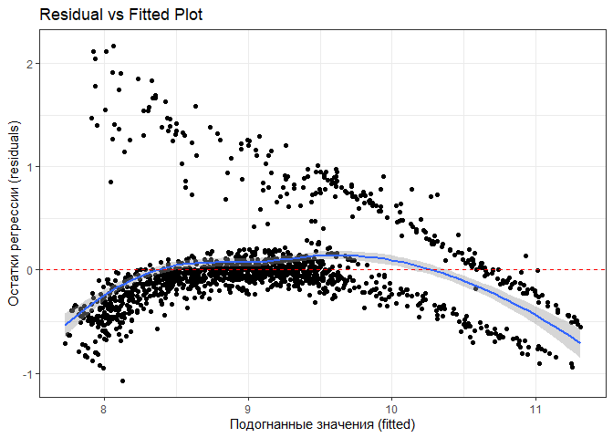
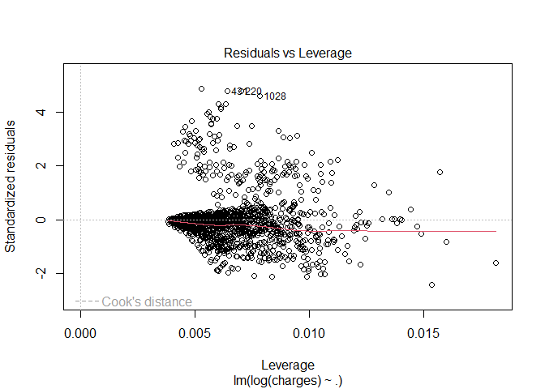
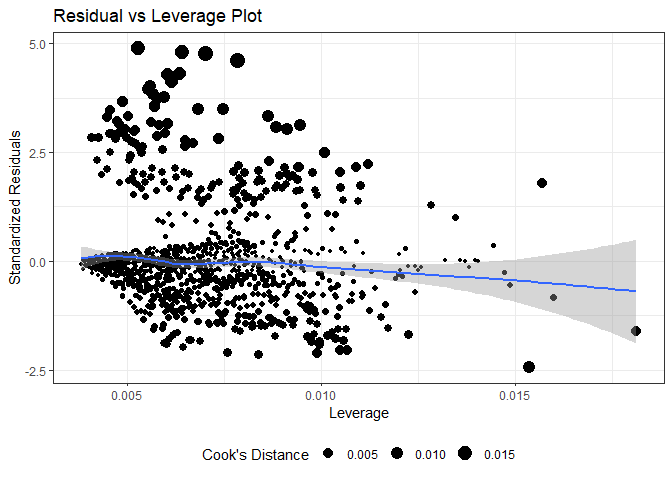
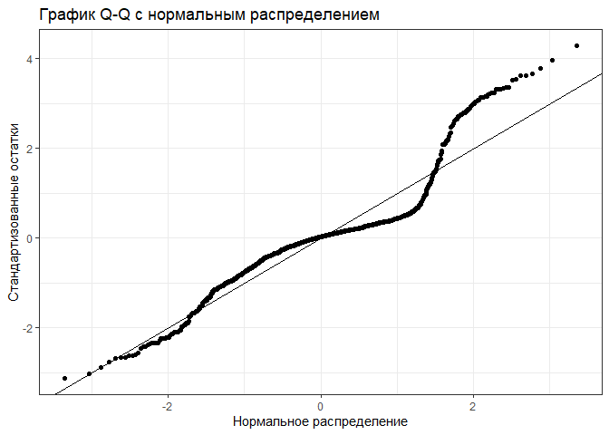
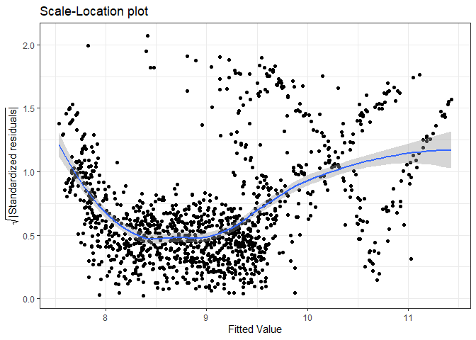

# ДЗ4. Линейная регрессия

## Винник Екатерина Петровна, 22.М04

    library(readr)
    library(dplyr)

    ## 
    ## Присоединяю пакет: 'dplyr'

    ## Следующие объекты скрыты от 'package:stats':
    ## 
    ##     filter, lag

    ## Следующие объекты скрыты от 'package:base':
    ## 
    ##     intersect, setdiff, setequal, union

    library(ggplot2)
    library(tidyr)
    options(readr.show_col_types = FALSE)
    insurance_data <- read_csv("data/insurance.csv")
    print(insurance_data)

    ## # A tibble: 1,338 × 7
    ##      age sex      bmi children smoker region    charges
    ##    <dbl> <chr>  <dbl>    <dbl> <chr>  <chr>       <dbl>
    ##  1    19 female  27.9        0 yes    southwest  16885.
    ##  2    18 male    33.8        1 no     southeast   1726.
    ##  3    28 male    33          3 no     southeast   4449.
    ##  4    33 male    22.7        0 no     northwest  21984.
    ##  5    32 male    28.9        0 no     northwest   3867.
    ##  6    31 female  25.7        0 no     southeast   3757.
    ##  7    46 female  33.4        1 no     southeast   8241.
    ##  8    37 female  27.7        3 no     northwest   7282.
    ##  9    37 male    29.8        2 no     northeast   6406.
    ## 10    60 female  25.8        0 no     northwest  28923.
    ## # ℹ 1,328 more rows

## Линейная регрессия, подгонка методом МНК (метод наименьших квадратов)

**Исследовательский вопрос:** как размер страховых выплат зависит от
остальных показателей?

Основной статистической моделью такой зависимости выбирается линейная
регрессия. Тогда размер страховых выплат – регрессанд, а остальные
переменные – предикторы. Прологарифмируем регрессанд, так как размер
страховых выплат не может быть отрицательным.

    rmodel_1 <- lm(log(charges)~., data=insurance_data)
    summary(rmodel_1)

    ## 
    ## Call:
    ## lm(formula = log(charges) ~ ., data = insurance_data)
    ## 
    ## Residuals:
    ##      Min       1Q   Median       3Q      Max 
    ## -1.07186 -0.19835 -0.04917  0.06598  2.16636 
    ## 
    ## Coefficients:
    ##                   Estimate Std. Error t value Pr(>|t|)    
    ## (Intercept)      7.0305581  0.0723960  97.112  < 2e-16 ***
    ## age              0.0345816  0.0008721  39.655  < 2e-16 ***
    ## sexmale         -0.0754164  0.0244012  -3.091 0.002038 ** 
    ## bmi              0.0133748  0.0020960   6.381 2.42e-10 ***
    ## children         0.1018568  0.0100995  10.085  < 2e-16 ***
    ## smokeryes        1.5543228  0.0302795  51.333  < 2e-16 ***
    ## regionnorthwest -0.0637876  0.0349057  -1.827 0.067860 .  
    ## regionsoutheast -0.1571967  0.0350828  -4.481 8.08e-06 ***
    ## regionsouthwest -0.1289522  0.0350271  -3.681 0.000241 ***
    ## ---
    ## Signif. codes:  0 '***' 0.001 '**' 0.01 '*' 0.05 '.' 0.1 ' ' 1
    ## 
    ## Residual standard error: 0.4443 on 1329 degrees of freedom
    ## Multiple R-squared:  0.7679, Adjusted R-squared:  0.7666 
    ## F-statistic: 549.8 on 8 and 1329 DF,  p-value: < 2.2e-16

Чтобы судить о валидности построенной регрессионной модели, посмотрим
качество подгонки модели и проведем анализ остатков регрессии.

### Качество подгонки модели

Для построенной модели коэффициент детерминации 0.77, таким образом, так
как коэффициент близок к 1, подогнанная регрессия объясняет большую
часть вариабельности ключевой переменной *размера страховых выплат*.

Кроме того, p–значение для F–критерия равно 0, таким образом гипотеза о
равенстве нулю всех коэффициентов при признаках не принимается на уровне
значимости 0.05, регрессия значима.

### Анализ остатков регрессии

#### Линейность взаимосвязи

    library(ggcorrplot)

    ## Warning: пакет 'ggcorrplot' был собран под R версии 4.3.3

    #можно вывести этот plot при помощи базовой графики
    #plot(rmodel_1, 1)

    p1<-ggplot(rmodel_1, aes(.fitted, .resid))+ geom_point() + stat_smooth(method="loess") + geom_hline(yintercept=0, col="red", linetype="dashed") + 
    labs(x="Подогнанные значения (fitted)", y="Остатки регрессии (residuals)", title = "Residual vs Fitted Plot")+theme_bw()

    p1

    ## `geom_smooth()` using formula = 'y ~ x'

С помощью графика о зависимости между подогнанными значениями и
остатками регрессии, представленного выше, можно оценить истинность
предположения о линейности взаимосвязи. Видно, что на графике
присутствуют выбросы. Для рассматриваемой модели можно говорить о
наличии выбросов, это примерно наблюдения с номерами 1, 2, 3, 4, 5, 6,
7, 8, 9, 10, 11, 12, 13, 14, 15, 16, 17, 18, 19, 20, 21, 22, 23, 24, 25,
26, 27, 28, 29, 30, 31, 32, 34, 35, 36, 37, 38, 39, 40, 41, 42, 43, 44,
45, 46, 47, 48, 49, 50, 51, 52, 53, 54, 55, 56, 57, 58, 59, 60, 61, 62,
63, 64, 65, 66, 67, 68, 69, 70, 71, 72, 73, 74, 75, 76, 77, 78, 79, 80,
81, 82, 83, 84, 85, 86, 87, 88, 89, 90, 91, 92, 93, 94, 95, 96, 97, 98,
99, 100, 101, 102, 103, 104, 105, 106, 107, 108, 109, 110, 111, 112,
113, 114, 115, 116, 117, 118, 119, 120, 121, 122, 123, 124, 125, 126,
127, 128, 129, 130, 131, 132, 133, 134, 135, 136, 137, 138, 139, 140,
141, 142, 143, 144, 145, 146, 147, 148, 149, 150, 151, 152, 153, 154,
155, 156, 157, 158, 159, 160, 161, 162, 163, 164, 165, 166, 167, 168,
169, 170, 171, 172, 173, 174, 175, 176, 177, 178, 180, 181, 182, 183,
184, 185, 186, 187, 188, 189, 190, 191, 192, 193, 194, 195, 196, 197,
198, 199, 200, 201, 202, 203, 204, 205, 206, 207, 208, 209, 210, 211,
212, 213, 214, 215, 216, 217, 218, 219, 220, 221, 222, 223, 224, 225,
226, 227, 228, 229, 230, 231, 232, 233, 234, 235, 236, 237, 238, 239,
240, 241, 242, 243, 244, 245, 246, 247, 248, 249, 250, 251, 252, 253,
254, 255, 256, 257, 258, 259, 260, 261, 262, 263, 264, 265, 266, 267,
268, 269, 270, 271, 272, 273, 274, 275, 276, 277, 278, 280, 281, 282,
283, 284, 285, 286, 287, 288, 289, 290, 291, 292, 293, 294, 295, 296,
297, 298, 299, 300, 301, 302, 303, 304, 305, 306, 307, 308, 309, 310,
311, 312, 313, 314, 315, 316, 317, 318, 319, 320, 321, 322, 323, 324,
325, 326, 327, 328, 329, 330, 331, 332, 333, 334, 335, 336, 337, 338,
339, 340, 341, 342, 343, 344, 345, 346, 347, 348, 349, 350, 351, 352,
353, 354, 355, 356, 357, 358, 359, 360, 361, 362, 363, 364, 365, 366,
367, 368, 369, 370, 371, 372, 373, 374, 375, 376, 377, 378, 379, 380,
381, 382, 383, 384, 385, 386, 387, 388, 389, 390, 391, 392, 393, 394,
395, 396, 397, 398, 399, 400, 401, 402, 403, 404, 405, 406, 408, 409,
410, 411, 412, 413, 414, 415, 416, 417, 418, 419, 420, 421, 422, 423,
424, 425, 427, 428, 429, 430, 431, 432, 433, 434, 435, 436, 437, 438,
439, 440, 441, 442, 443, 444, 445, 447, 448, 449, 450, 451, 452, 453,
454, 455, 456, 458, 459, 460, 461, 462, 463, 464, 465, 466, 467, 468,
469, 470, 471, 472, 473, 474, 475, 476, 477, 478, 479, 480, 481, 482,
483, 484, 485, 486, 487, 488, 489, 490, 491, 492, 493, 494, 495, 496,
497, 498, 499, 500, 501, 502, 503, 504, 505, 506, 507, 508, 509, 510,
511, 512, 513, 514, 515, 516, 517, 518, 519, 520, 521, 522, 523, 524,
525, 526, 527, 528, 529, 530, 531, 532, 533, 534, 535, 536, 537, 538,
539, 540, 541, 542, 544, 545, 546, 547, 548, 549, 550, 551, 552, 553,
554, 555, 556, 557, 558, 559, 560, 561, 562, 563, 564, 565, 566, 567,
568, 569, 570, 571, 572, 573, 574, 575, 576, 577, 578, 579, 580, 581,
582, 583, 584, 585, 586, 588, 589, 590, 591, 592, 593, 594, 595, 596,
597, 598, 599, 600, 601, 602, 603, 604, 605, 606, 607, 608, 609, 610,
611, 612, 613, 614, 615, 616, 617, 618, 619, 620, 621, 622, 623, 624,
625, 626, 627, 628, 630, 631, 632, 633, 634, 635, 636, 637, 638, 639,
640, 641, 642, 643, 644, 645, 646, 647, 648, 649, 650, 651, 652, 653,
654, 655, 656, 657, 658, 659, 660, 661, 662, 663, 664, 665, 666, 667,
668, 669, 670, 671, 672, 673, 674, 676, 677, 678, 679, 680, 681, 682,
683, 684, 685, 686, 687, 688, 689, 690, 691, 692, 693, 694, 695, 696,
697, 698, 699, 700, 701, 702, 703, 704, 705, 706, 708, 709, 710, 711,
712, 713, 714, 715, 716, 717, 718, 719, 720, 721, 722, 724, 726, 727,
728, 729, 730, 731, 732, 733, 734, 735, 736, 737, 738, 739, 740, 741,
742, 743, 744, 745, 747, 748, 749, 750, 751, 752, 753, 754, 755, 756,
757, 758, 759, 760, 761, 762, 763, 764, 765, 766, 767, 768, 769, 770,
771, 772, 773, 774, 775, 776, 777, 778, 779, 780, 781, 782, 784, 785,
786, 787, 788, 789, 790, 791, 792, 793, 794, 795, 796, 797, 798, 799,
800, 801, 803, 804, 805, 806, 807, 808, 809, 810, 811, 812, 813, 814,
815, 816, 817, 818, 819, 820, 821, 822, 823, 824, 825, 826, 827, 828,
829, 830, 831, 832, 834, 835, 836, 837, 838, 839, 840, 841, 842, 843,
844, 845, 846, 847, 848, 849, 850, 851, 852, 854, 855, 856, 857, 858,
859, 860, 861, 862, 863, 864, 865, 866, 867, 868, 869, 870, 871, 872,
873, 874, 875, 876, 877, 878, 879, 880, 881, 882, 883, 884, 885, 886,
887, 888, 889, 890, 891, 892, 893, 894, 895, 896, 897, 898, 899, 900,
901, 902, 903, 904, 906, 907, 908, 909, 910, 911, 912, 913, 914, 916,
917, 918, 919, 920, 921, 922, 923, 924, 925, 926, 927, 928, 929, 930,
931, 932, 933, 934, 935, 936, 937, 938, 939, 940, 941, 942, 943, 944,
945, 946, 947, 948, 949, 950, 951, 952, 953, 954, 955, 956, 957, 958,
959, 960, 961, 962, 963, 964, 965, 966, 967, 968, 969, 970, 971, 972,
973, 974, 975, 976, 977, 978, 979, 980, 981, 982, 983, 984, 985, 986,
987, 988, 989, 990, 991, 992, 993, 994, 995, 996, 997, 998, 999, 1001,
1002, 1003, 1004, 1005, 1006, 1007, 1008, 1009, 1010, 1011, 1012, 1013,
1014, 1015, 1016, 1017, 1018, 1019, 1020, 1022, 1023, 1024, 1025, 1026,
1027, 1028, 1029, 1030, 1031, 1032, 1033, 1034, 1035, 1036, 1037, 1039,
1040, 1041, 1042, 1043, 1044, 1045, 1046, 1047, 1048, 1049, 1050, 1051,
1052, 1053, 1054, 1055, 1056, 1057, 1058, 1059, 1060, 1061, 1062, 1063,
1064, 1065, 1066, 1067, 1068, 1069, 1070, 1071, 1072, 1073, 1074, 1075,
1076, 1078, 1079, 1080, 1081, 1082, 1083, 1084, 1085, 1086, 1087, 1088,
1089, 1090, 1091, 1093, 1094, 1095, 1096, 1097, 1098, 1099, 1100, 1101,
1102, 1103, 1104, 1105, 1106, 1107, 1108, 1109, 1110, 1111, 1112, 1113,
1114, 1115, 1116, 1117, 1118, 1119, 1120, 1121, 1122, 1123, 1124, 1125,
1126, 1127, 1128, 1129, 1130, 1131, 1132, 1133, 1134, 1135, 1136, 1137,
1138, 1139, 1140, 1141, 1142, 1143, 1144, 1145, 1146, 1147, 1148, 1149,
1150, 1151, 1152, 1153, 1154, 1155, 1156, 1157, 1158, 1159, 1160, 1161,
1162, 1163, 1164, 1165, 1166, 1167, 1168, 1169, 1170, 1171, 1172, 1173,
1174, 1175, 1176, 1177, 1178, 1179, 1180, 1181, 1182, 1183, 1184, 1185,
1186, 1187, 1188, 1189, 1190, 1191, 1192, 1193, 1194, 1196, 1197, 1198,
1199, 1200, 1201, 1202, 1203, 1204, 1205, 1206, 1207, 1208, 1209, 1210,
1211, 1212, 1213, 1214, 1215, 1216, 1217, 1218, 1219, 1220, 1221, 1222,
1223, 1224, 1225, 1226, 1227, 1228, 1229, 1230, 1231, 1232, 1233, 1234,
1235, 1236, 1237, 1238, 1239, 1240, 1241, 1242, 1243, 1244, 1245, 1246,
1247, 1248, 1249, 1250, 1251, 1252, 1253, 1254, 1255, 1256, 1257, 1258,
1259, 1260, 1261, 1262, 1263, 1264, 1265, 1266, 1267, 1268, 1269, 1270,
1271, 1272, 1273, 1274, 1275, 1276, 1277, 1278, 1279, 1280, 1281, 1282,
1283, 1284, 1285, 1286, 1287, 1288, 1289, 1290, 1291, 1292, 1293, 1294,
1295, 1296, 1297, 1298, 1299, 1300, 1301, 1302, 1303, 1304, 1305, 1306,
1307, 1308, 1309, 1310, 1311, 1312, 1313, 1314, 1315, 1316, 1317, 1318,
1319, 1320, 1321, 1322, 1323, 1324, 1325, 1326, 1327, 1328, 1329, 1330,
1331, 1332, 1333, 1334, 1335, 1336, 1337, 1338.

Для более полного анализа выбросов, используем расстояние Кука (Cook’s
distance), которое отражает, насколько сильно изменится предсказание при
удалении каждого наблюдения. Обычно выбросами считаются те наблюдения,
для которых расстояние Кука больше, чем 4/*n*, или 0.0029 в нашем
случае.

    plot(rmodel_1, 5)

    #или

    p5 <- ggplot(rmodel_1, aes(.hat, .stdresid)) + 
      geom_point(aes(size=.cooksd), na.rm=TRUE) + 
      stat_smooth(method="loess", na.rm=TRUE) + 
      labs(x="Leverage", y="Standardized Residuals", title = "Residual vs Leverage Plot") + 
      scale_size_continuous("Cook's Distance", range=c(1,5)) + 
      theme_bw()+theme(legend.position="bottom")

    #создадим индекс, который определяет соответствие наблюдения эпирическому правилу о выбросах
    inx <- ifelse(cooks.distance(rmodel_1) < 4/1338, "keep","delete")

    p5

    ## `geom_smooth()` using formula = 'y ~ x'

Оставим в модели только те наблюдения, которые не считаются выбросами.

    rmodel_1_mod <- lm(log(charges)~., data=insurance_data[inx=='keep',])
    summary(rmodel_1_mod)

    ## 
    ## Call:
    ## lm(formula = log(charges) ~ ., data = insurance_data[inx == "keep", 
    ##     ])
    ## 
    ## Residuals:
    ##      Min       1Q   Median       3Q      Max 
    ## -0.84090 -0.10713  0.00638  0.07927  1.15633 
    ## 
    ## Coefficients:
    ##                   Estimate Std. Error t value Pr(>|t|)    
    ## (Intercept)      6.8196514  0.0454997 149.883  < 2e-16 ***
    ## age              0.0406616  0.0005661  71.824  < 2e-16 ***
    ## sexmale         -0.0913970  0.0154672  -5.909 4.45e-09 ***
    ## bmi              0.0094183  0.0013461   6.997 4.30e-12 ***
    ## children         0.1126506  0.0064189  17.550  < 2e-16 ***
    ## smokeryes        1.6006459  0.0197729  80.951  < 2e-16 ***
    ## regionnorthwest -0.0771262  0.0222195  -3.471 0.000536 ***
    ## regionsoutheast -0.1413247  0.0223182  -6.332 3.38e-10 ***
    ## regionsouthwest -0.1165611  0.0222003  -5.250 1.79e-07 ***
    ## ---
    ## Signif. codes:  0 '***' 0.001 '**' 0.01 '*' 0.05 '.' 0.1 ' ' 1
    ## 
    ## Residual standard error: 0.2708 on 1227 degrees of freedom
    ## Multiple R-squared:  0.9096, Adjusted R-squared:  0.909 
    ## F-statistic:  1543 on 8 and 1227 DF,  p-value: < 2.2e-16

#### Нормальность остатков регрессии

Применим критерий Лиллиефорса для проверки на нормальность из пакета
nortest.

    nortest::lillie.test(rstandard(rmodel_1_mod))

    ## 
    ##  Lilliefors (Kolmogorov-Smirnov) normality test
    ## 
    ## data:  rstandard(rmodel_1_mod)
    ## D = 0.17482, p-value < 2.2e-16

p-значение меньше 0,05, значит гипотеза о близости остатков нормальному
распределению не может быть принята на уровне значимости 0.05.

    p2 <- ggplot(rmodel_1_mod, aes(qqnorm(.stdresid)[[1]], .stdresid)) + 
      geom_point(na.rm = TRUE) + 
      geom_abline() + 
      labs(x = "Нормальное распределение", y = "Стандартизованные остатки", title = "График Q-Q с нормальным распределением") + 
      theme_bw()

    p2

Исходя из графика квантиль-квантиль, представленного выше, также нельзя
сказать о нормальности остатков регрессии – наблюдаются расхождения в
правой части графика.

#### Однородность дисперсии остатков

Оценим гомоскедастичность при помощи статистических критериев и
графически.

    #один из базовых критериев для проверки на гомоскедастичность
    car::ncvTest(rmodel_1_mod)

    ## Non-constant Variance Score Test 
    ## Variance formula: ~ fitted.values 
    ## Chisquare = 183.0957, Df = 1, p = < 2.22e-16

    ggplot(rmodel_1_mod, aes(.fitted, sqrt(abs(.stdresid)))) + 
      geom_point(na.rm=TRUE) + 
      stat_smooth(method="loess", na.rm = TRUE) + 
      labs(x="Fitted Value", y = expression(sqrt("|Standardized residuals|")), title = "Scale-Location plot") + 
      theme_bw()

    ## `geom_smooth()` using formula = 'y ~ x'

В нашем случае p-значение для критерия меньше 0.05, и потому гипотеза об
однородности дисперсии не принимается, графически также наблюдается
достаточное число отклонений в правой части.

В целом, простая линейная регрессия приемлемо описывает интересующий
признак, размер страховых расходов: значительных отклонений от
предпосылок модели не наблюдается, регрессия в целом значима, описывает
77% вариабельности признака.

**Интерпретация коэффициентов линейной регрессии**

Итоговая регрессия (с учетом удаленных выбросов) позволяет
охарактеризовать плотность в терминах других характеристик следующим
образом:

-   увеличение показателя age на 1 влечёт увеличение размера страховой
    выплаты на 0.041;
-   увеличение показателя sexmale на 1 влечёт снижение размера страховой
    выплаты на 0.091;
-   увеличение показателя bmi на 1 влечёт увеличение размера страховой
    выплаты на 0.009;
-   увеличение показателя children на 1 влечёт увеличение размера
    страховой выплаты на 0.112;
-   увеличение показателя smokeryes на 1 влечёт увеличение размера
    страховой выплаты на 1.6;
-   увеличение показателя regionnorthwest на 1 влечёт снижение размера
    страховой выплаты на 0.077;
-   увеличение показателя regionsoutheast на 1 влечёт снижение размера
    страховой выплаты на 0.141;
-   увеличение показателя regionsouthwest на 1 влечёт снижение размера
    страховой выплаты на 0.116.
